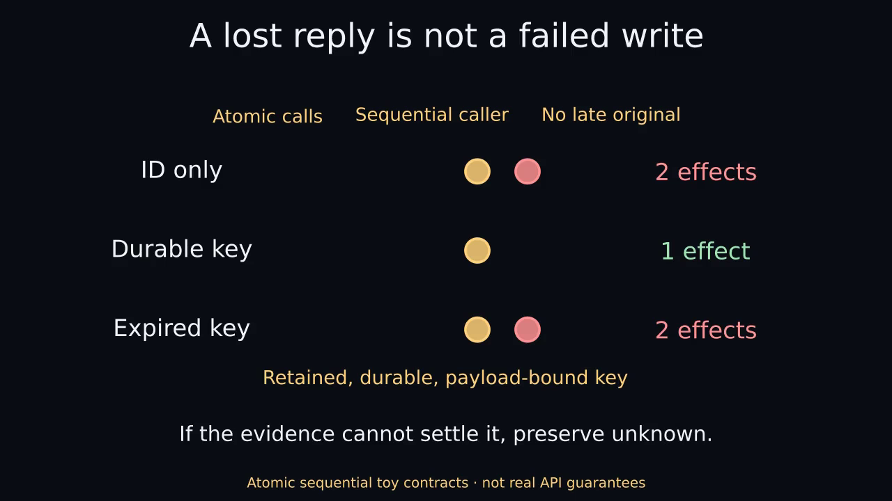
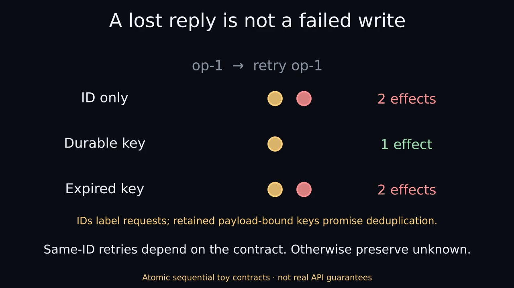

# After the Timeout

A tool call times out. Did the write fail, finish, or leave only part of a batch committed? Retrying can create duplicates; stopping can leave legitimate work unfinished.

This project studies how recovery should depend on the evidence an interface exposes. Deterministic simulators cover uncertain writes, stale status, expiring keys, late commits and partial batches. Related work examines checkpoint handoffs, retained experiment evidence and how to report what is still unknown.

## Start here

- [Trace one uncertain write by hand](docs/START_HERE.md).
- [Read the research overview](docs/RESEARCH_OVERVIEW.md) for questions, controls, related work and falsifiable next steps.
- [Browse the completed studies](MILESTONES.md), [partial-commit report](milestones/partial-commit/REPORT.md) and [public capability catalog](docs/public-capabilities.md).

## Watch the narrated explanation

[](docs/animations/narrated/concept.mp4)

[56.1-second narrated MP4](docs/animations/narrated/concept.mp4) · [Complete transcript](docs/animations/narrated/transcript.txt) · [Captions](docs/animations/narrated/captions.vtt) · [Editable source and reproduction](docs/animations/narrated/RENDERING.md)

Speech-led Manim animation with a synthetic stock voice. Synthetic contracts · not real api guarantees. This is an explanatory upgrade, not a new experimental result. Captions have approximate sentence timing. The [static-first viewer](docs/animations/narrated/index.html), poster and complete transcript provide a no-motion alternative. The original silent version and its historical QA remain unchanged below.

## Watch the concept in 24 seconds

[](docs/animations/concept.mp4)

[24-second Manim MP4](docs/animations/concept.mp4) · [Optional GIF preview](docs/animations/concept.gif) · [Text transcript](docs/animations/transcript.txt) · [Captions](docs/animations/captions.vtt)

Rendered with Manim Community 0.22.0. Synthetic contracts · not real API guarantees. No audio. The poster and transcript provide a no-motion alternative. The downloaded [HTML viewer](docs/animations/index.html) is static by default and never autoplays.

The simulators test explicit policies under declared contracts. They do not estimate production incident rates or show that a language model will follow a written skill.

## Baseline result

**Inspecting first helped under the baseline's contracts.** Blind retry produced six duplicate commits across 48 trials; inspect-first produced none, using 84 rather than 72 calls and leaving six outcomes unresolved. Those trials reorder 16 unique scenarios, so they are not 48 independent incidents.

## Follow-on studies

**Weakening the contracts exposed new failures.** A [stale status read](milestones/stale-status/README.md) defeated inspect-first recovery. [Key expiry](milestones/key-lifetime/README.md) restored duplicate risk. [Late original commits](milestones/late-commit/README.md) produced duplicates even after a policy had returned success. A completion report needs a stated observation horizon.

**Partial batches need item-level reasoning.** In [256 constructed cases](milestones/partial-commit/REPORT.md), no-key evidence-only recovery avoided extra effects but left outcomes unresolved. With durable item keys, both the capability-aware policy and blind keyed baseline were exact-once in all 32 cases of their respective groups; the blind baseline used fewer calls. The result depends on terminal original operations and truthful, durable contracts.

**Handoff evidence needs separate validation.** [Checkpoint tests](milestones/checkpoint-handoff/README.md) check missing or mismatched artifacts. One [held-out fictional-case review](milestones/handoff-review/results/REPORT.md) matched 48 predeclared written fields across eight cases. That small review does not measure live execution or approval compliance.

## Reproduce

Python 3.10+ standard library only. From the repository root:

```sh
python tools/run_all_tests.py
python tools/reproduce.py --study baseline --out ../atlas-baseline-run-001
```

Use a new output directory outside the repository with an existing parent. The wrapper copies unchanged study sources and protects historical outputs. Preserved legacy `run_experiment.py` scripts can overwrite their original result files; use the wrapper instead. The [reproduction guide](docs/reproduction.md) lists the aggregate matrix and later suites, which have separate entrypoints.

Historical manifests cover their recorded snapshots. New reproduction manifests describe the fresh source/output set; they do not retroactively validate every later addition.

## Public interface atlas

The [capability catalog](docs/public-capabilities.md) separates tool discovery, schemas, pagination, writes and status observation. Check the actually exposed operation and its contract before choosing a recovery path. Vendor documentation describes possible interfaces; it does not establish an account's access or a connector's capabilities.

## Reuse the workflows, then test them

Original public skills cover [uncertain writes](skills/recover-uncertain-operation/SKILL.md), [partial batches](skills/recover-partial-batch/SKILL.md), [checkpoint handoffs](skills/checkpoint-handoff/SKILL.md), [evidence retention](skills/retain-experiment-evidence/SKILL.md), [release validation](skills/release-validation/README.md) and [plain language](skills/plain-language/SKILL.md). Their format, fixture and software checks are recorded separately from behavioral efficacy.

Next work should compare model-assisted recovery under controlled observation, action and cost budgets, then test broader service contracts. Measure duplicates, actual completion, justified completion reports, unresolved outcomes and cost separately. [The overview](docs/RESEARCH_OVERVIEW.md) explains the design.

Original code, skills, documentation and synthetic results are [MIT licensed](LICENSE). Linked standards and papers retain their copyrights. The catalog describes public interfaces rather than anyone's account access.

## Recovery composition study

[Complete scheduler-path evidence and bounded recovery analysis](studies/recovery-composition/README.md) retain the failed completion prediction P5 and show no composed-policy superiority: the adequate single-operation policy justifies 423 cases versus 417 for the composed policy. The six losses instantiate one structural defect, not six independent discoveries. Supplementary impossibility reasoning is limited to its declared action alphabet, and cache semantics are model-specific. These are offline contract-model results, not real API or agent-behavior guarantees.

The [saved-trace policy-attribution supplement](studies/recovery-composition/policy-attribution/README.md) checks original per-row dynamics first, then whether the named policy selected each recorded action. It is post-hoc verification of retained evidence, not a new policy result or a whole-dataset completeness proof.
